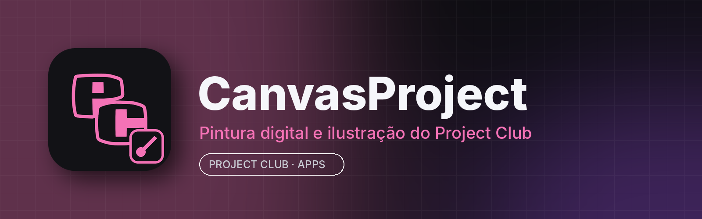

# CanvasProject

**CanvasProject** é o app de **pintura digital e ilustração** do **Project Club**: pincéis realistas, camadas, mesa digitalizadora, animação quadro a quadro, quadrinhos e pixel art — com o tema do Project Club e integrado à aba **Apps**.

É uma versão modificada do **[Krita](https://krita.org)** (código aberto, GNU GPL v3). Todos os recursos do Krita continuam aqui; o CanvasProject troca o nome, o ícone, a tela de abertura, o tema padrão e a integração com o Project Club.

## Principais recursos

- Mais de 100 pincéis prontos e motores de pincel (pixel, cor inteligente, partículas, filtros...)
- Camadas de pintura, vetor, filtro, preenchimento, máscaras e grupos
- Estabilizador de traço, assistentes de perspectiva e régua
- Animação quadro a quadro com papel cebola e linha do tempo
- Ferramentas para quadrinhos, texto e balões
- Gerenciamento de cor (ICC, OCIO), HDR
- Abre e salva KRA, PSD, PNG, JPEG, WebP, TIFF, EXR e mais
- Tema escuro do Project Club com destaque rosa (padrão)

## Instalar

Pelo **Project Club**: aba **Apps → CanvasProject → Instalar**. Manual: [Releases](../../releases/latest)
- **Windows 10/11 (64 bits):** `CanvasProject-<versão>-win.zip` → extraia e abra `bin/CanvasProject.exe`
- **Linux (x86_64):** `CanvasProject.AppImage` → `chmod +x` e execute

## Requisitos

| | Mínimo | Recomendado |
|---|---|---|
| Sistema | Windows 10 64 bits / Linux x86_64 (glibc 2.35+) | Windows 11 / Ubuntu 22.04+ |
| CPU | 2 núcleos com SSE4.1 | 4+ núcleos |
| RAM | 4 GB (o app usa ~400 MB–2 GB conforme o tamanho da tela) | 8–16 GB |
| GPU | OpenGL 3.0 / Direct3D 11 (ANGLE) | qualquer GPU recente |
| Disco | ~600 MB + projetos | SSD |
| Entrada | mouse | mesa digitalizadora com pressão (Wacom, XP-Pen, Huion) |

## Compilar

Igual ao Krita (veja [docs.krita.org — Building Krita](https://docs.krita.org/en/untranslatable_pages/building_krita.html)). O workflow **Build CanvasProject release** usa as mesmas dependências pré-compiladas públicas do CI do Krita (invent.kde.org) para gerar os pacotes do Project Club, as capturas de tela e a release.

## Créditos e licença

CanvasProject é uma versão modificada do **Krita**, © 1999–2026 The Krita Developers, distribuída sob a **GNU General Public License v3** — veja [COPYING](COPYING) e a pasta [LICENSES](LICENSES). Krita® é marca da Krita Foundation; o CanvasProject não é afiliado nem endossado pela Krita Foundation. O código-fonte completo com as modificações está neste repositório. README original: [docs/README-Krita-original.md](docs/README-Krita-original.md).
